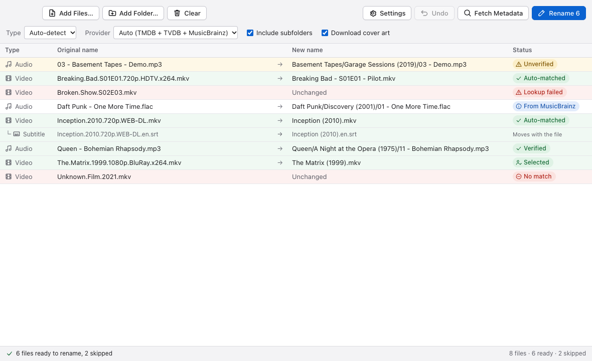

# TidyTitles

TidyTitles renames movie, TV, and music files to clean, consistent names. It reads each filename (and, for music, the file's tags), looks the file up on [TMDB](https://www.themoviedb.org/) (movies and TV), [TVDB](https://thetvdb.com/) (TV), or [MusicBrainz](https://musicbrainz.org/) (music), and builds the new name from a template you can change. You see every new name before anything is renamed, and you can undo the last rename.

There are two ways to use it, and they share the same settings and rename history:

- a **desktop app** for macOS, Windows, and Linux, and
- a **command-line tool**, `tidytitles`, for scripts and terminals.



## What it does

- **Reads filenames and tags.** Works out whether a file is a movie, a TV episode, or music. Music files are always treated as music, and their tags (ID3, Vorbis, FLAC, MP4, and others) are read first, with the filename as a fallback.
- **Looks up metadata.** TMDB for movies (and TV, if you prefer it), TVDB for TV, MusicBrainz for music. TMDB and TVDB need a free API key; MusicBrainz needs none.
- **Asks when a search is ambiguous.** When several results match, you pick one or skip the file.
- **Renames with templates.** `{title} ({year})`, `{title} - S{season2}E{episode2} - {episode_title}`, and so on. A `/` in a template creates folders.
- **Moves associated files along.** Subtitles (`Movie.en.srt`), `.nfo` files, and images with the same base name get the matching new name.
- **Handles name clashes your way.** Skip the file, replace the existing file, or add a number such as `(1)`.
- **Downloads cover art** (optional). Movie and TV posters from TMDB, album covers from the Cover Art Archive.
- **Undoes the last rename,** from either the app or the command line, even after a restart.

## Examples

With the default templates:

```
One.Battle.After.Another.2025.1080p.AMZN.WEB-DL.DDP5.1.H.264-KyoGo.mkv
  → One Battle After Another (2025).mkv

Breaking.Bad.S01E01.720p.BluRay.x264.mkv
  → Breaking Bad - S01E01 - Pilot.mkv
Breaking.Bad.S01E01.720p.BluRay.x264.en.srt
  → Breaking Bad - S01E01 - Pilot.en.srt

06 - Comfortably Numb.flac  (tags: Pink Floyd, The Wall, 1979, track 6)
  → Pink Floyd/The Wall (1979)/06 - Comfortably Numb.flac
```

The music template creates an artist folder and an album folder next to the original file.

## Install

Download the installer for your system from the [Releases page](https://github.com/chrisoflaherty/TidyTitles/releases):

| System | File |
|--------|------|
| macOS, Apple silicon (M1 and later) | `TidyTitles-<version>-macos-arm64.dmg` |
| macOS, Intel | `TidyTitles-<version>-macos-x64.dmg` |
| Windows (64-bit) | `TidyTitles-<version>-windows-setup.exe` |
| Linux (64-bit) | `TidyTitles-<version>-x86_64.AppImage` |

The installers are **not code signed**, so macOS and Windows warn you the first time. [Installation](wiki/Installation.md) explains each warning and how to get past it, and how to add the `tidytitles` command to your terminal.

### Updates

The desktop app checks for new versions shortly after it starts and every few hours, downloads them in the background, and shows **Restart to Update** in the status bar when one is ready (or installs it when you quit). **Check for Updates…** is in the **TidyTitles** menu on macOS and the **Help** menu on Windows and Linux; **Settings** → **Updates** turns automatic checks off. Beta versions are offered newer betas and stable releases; stable versions only stable releases.

- **Windows:** updates install themselves. The installer now installs for the current user by default, so neither installing nor updating asks for administrator permission. If you installed 0.2.0-beta.2 or earlier (installed for all users), see [Installation](wiki/Installation.md#windows).
- **macOS:** the current builds are not signed with a Developer ID, and macOS lets only signed apps replace themselves. Until the builds are signed, the app tells you about a new version and offers **Download** instead.
- **Linux:** updates install themselves when you run the AppImage.

Details: [Installation → Updates](wiki/Installation.md#updates).

To build from source instead, you need Node.js 22.12 or newer:

```bash
git clone https://github.com/chrisoflaherty/TidyTitles.git
cd TidyTitles
npm install
npm run build
npx tidytitles --help
```

## Quick start

### Desktop app

1. Open TidyTitles, click **Settings**, and enter a TMDB API key on the **API Keys** tab (see [API Keys](wiki/API-Keys.md)). Skip this if you only rename music.
2. Drag files or folders into the window, or use **Add Files…** / **Add Folder…**.
3. Click **Fetch Metadata**. If a search finds several matches, choose one.
4. Check the **New name** column, then click **Rename**.
5. Changed your mind? Click **Undo**.

The [GUI Guide](wiki/GUI-Guide.md) covers every control.

### Command line

```bash
# Save your TMDB key (once)
tidytitles config set-key tmdb YOUR_TMDB_API_KEY

# See what would happen, without renaming anything
tidytitles rename ~/Downloads --dry-run

# Rename for real (asks "Proceed with rename?" first)
tidytitles rename ~/Downloads

# Music needs no API key
tidytitles rename ~/Music/Inbox --type music

# Put things back
tidytitles undo
```

The [CLI Reference](wiki/CLI-Reference.md) lists every command and option.

## Moving from the Python version

TidyTitles was first written in Python (the `file-renamer` command and a PySide6 window). This version replaces it:

- **Same settings and history.** It reads and writes the same `config.toml` and `history.json` in the same folder, so your API keys, templates, and last 10 renames carry over. You can even undo a rename the Python app made.
- **Same command name.** `file-renamer` still works as another name for `tidytitles` when you run the CLI from a source checkout. (The desktop app's **Install Command Line Tool…** installs only `tidytitles`.)
- **Some behavior changed:**
  - Renames that only change letter case (`the matrix (1999).mkv` → `The Matrix (1999).mkv`) now work, also on case-insensitive disks.
  - A failed lookup for one file (a network error, a rejected key) no longer stops the whole batch; that file is skipped and reported.
  - The CLI exits with status 1 when any rename or lookup failed.
  - `conflict_resolution = "overwrite"` now really replaces the existing file (the Python app quietly skipped it). It never replaces another file that is part of the same batch.
  - Undo works from the saved history in both the desktop app and the CLI, including after you restart the app.
  - Scanning skips hidden files and folders and matches extensions regardless of case (`.MKV` counts).
  - Music files are always looked up as music, even when you choose Movies or TV Shows.

More detail is in [Getting Started](wiki/Getting-Started.md#coming-from-the-python-version).

## Documentation

- [Installation](wiki/Installation.md): installers, unsigned-app warnings, the command-line tool, building from source
- [Getting Started](wiki/Getting-Started.md): first rename, step by step
- [GUI Guide](wiki/GUI-Guide.md): the desktop app
- [CLI Reference](wiki/CLI-Reference.md): every command, option, exit code, and environment variable
- [Templates](wiki/Templates.md): placeholders, formatters, folders, and how names are cleaned
- [Configuration](wiki/Configuration.md): `config.toml`, file locations, history, cache
- [API Keys](wiki/API-Keys.md): getting TMDB and TVDB keys
- [Troubleshooting](wiki/Troubleshooting.md): common problems
- [BUILD.md](BUILD.md): developing, testing, packaging, and releasing

## Development

```bash
npm install          # all workspaces
npm run build        # core, then CLI, then desktop (in that order)
npm test             # unit tests in every workspace
npm run typecheck
```

The repository is an npm-workspace monorepo: `packages/core` (all the logic), `packages/cli` (the `tidytitles` command), and `apps/desktop` (the Electron app). See [BUILD.md](BUILD.md) for the layout, the desktop end-to-end tests, and how releases are made.

## License

MIT. See [LICENSE](LICENSE).
