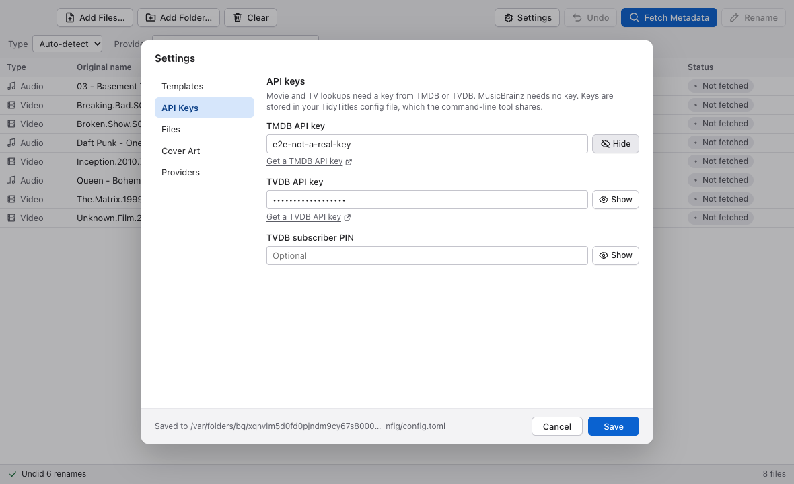

# API Keys

TidyTitles looks up movies and TV shows on TMDB and TVDB, which require a free API key. Music lookups use MusicBrainz, which needs no key. This page explains which keys you need, how to get them, and where to put them.

## Which keys you need

| Service | Used for | Cost | Key needed? |
|---------|----------|------|-------------|
| [TMDB](https://www.themoviedb.org/) (The Movie Database) | Movies, and TV if you prefer it | Free for personal use | Yes |
| [TVDB](https://thetvdb.com/) (TheTVDB) | TV shows | See TVDB's plans | Yes |
| [MusicBrainz](https://musicbrainz.org/) | Music | Free | No |

- **Movies** need a TMDB key. TVDB is never used for movies.
- **TV** works with either key. With both, TVDB is used by default; change that in **Settings** → **Providers** or with `[providers] tv = "tmdb"` in `config.toml`.
- **Music** needs nothing.

So one TMDB key is enough for everything. Without any key, the desktop app still runs but only looks up music, and the CLI asks you to set a key unless you use `--type music` or `--provider musicbrainz`.

## Getting a TMDB key

1. Create a free account at https://www.themoviedb.org/signup and confirm your email address.
2. Go to https://www.themoviedb.org/settings/api (in the desktop app, **Settings** → **API Keys** → **Get a TMDB API key** opens it).
3. Request an API key. Choose the developer/personal option and fill out the form; for the application name and description, something like "TidyTitles, personal media renaming" is fine.
4. Copy one of the two values shown:
   - **API Key** (a 32-character string), or
   - **API Read Access Token** (a much longer string starting with `eyJ`).

Either works. TidyTitles sends a value longer than 50 characters as a Read Access Token (an `Authorization: Bearer` header) and a shorter one as an API key (the `api_key` parameter).

## Getting a TVDB key

1. Create an account at https://thetvdb.com/.
2. Go to https://thetvdb.com/api-information (or **Settings** → **API Keys** → **Get a TVDB API key** in the app) and follow the steps for an API key. TVDB's terms and plans change from time to time; check that page for the current options.
3. Copy the API key.
4. If your TVDB plan gives you a **subscriber PIN**, you can enter it too. It is optional; TidyTitles sends it along when it logs in to TVDB.

TidyTitles uses TVDB's v4 API.

## Entering your keys

### Desktop app

**Settings** → **API Keys**. Paste the key into **TMDB API key** and/or **TVDB API key** (and **TVDB subscriber PIN** if you have one), then click **Save**. Click **Show** to check what you pasted. Leading and trailing spaces are removed.



The **Provider** menu in the main window updates to offer the services you now have keys for.

### Command line

```bash
tidytitles config set-key tmdb YOUR_TMDB_API_KEY
tidytitles config set-key tvdb YOUR_TVDB_API_KEY
```

Check which keys are set (the keys themselves are never printed):

```bash
tidytitles config show
```

```
API Keys:
  TMDB: configured
  TVDB: not set
```

There is no command for the TVDB PIN; set it in the desktop app or in `config.toml`.

### config.toml

Both the app and the CLI store keys in the `[api]` section of `config.toml` (see [Configuration](Configuration.md#where-files-are-stored) for its location):

```toml
[api]
tmdb_api_key = "your TMDB key"
tvdb_api_key = "your TVDB key"
tvdb_pin = ""
```

The app and the CLI share this file, so a key entered in one works in the other. The Python version of TidyTitles used the same file, so if you set keys there, they are already in place.

## Using environment variables

You can supply keys through `FILE_RENAMER_API__TMDB_API_KEY`, `FILE_RENAMER_API__TVDB_API_KEY`, and `FILE_RENAMER_API__TVDB_PIN` instead of storing them:

```bash
export FILE_RENAMER_API__TMDB_API_KEY=your_tmdb_key
tidytitles rename /media/movies --type movie --yes --auto-select
```

A value in `config.toml` wins over the environment, **even an empty one**. Once `config.toml` exists (any save writes `tmdb_api_key = ""`), remove the `tmdb_api_key` / `tvdb_api_key` lines from it, or the environment variables are ignored. See [Precedence](Configuration.md#precedence).

## Keeping keys safe

- `config.toml` stores keys as plain text in your user folder. Do not share the file or commit it to a repository.
- `config set-key` puts the key in your shell history. Use the desktop app or edit `config.toml` if you would rather avoid that.
- TidyTitles never prints keys: `config show` and `config show --json` only say "configured" or "not set".
- The TMDB and TVDB keys only allow reading data. If a key leaks, generate a new one on the service's website and revoke the old one.

## When a key is rejected

If a service rejects your key, the affected files are skipped and the rest of the batch continues:

- **Desktop app:** the files show the status **API key rejected**. Open **Settings** → **API Keys** and check the key.
- **CLI:** you see `Error: Metadata lookup failed for N file(s): Invalid TMDB API key` (or `Invalid TVDB API key`), followed by a hint to check `tidytitles config show`, and the command exits with status 1.

Things to check:

- The whole key was copied, with no extra characters.
- For TMDB, try the other value (API Key versus Read Access Token).
- For TVDB, make sure your account and API access are active.

You can test a TMDB key outside TidyTitles with curl. A working key returns JSON about *Fight Club* (movie 550):

```bash
# API Key (32 characters)
curl "https://api.themoviedb.org/3/movie/550?api_key=YOUR_KEY"

# Read Access Token
curl -H "Authorization: Bearer YOUR_TOKEN" "https://api.themoviedb.org/3/movie/550"
```

If the services limit your requests, files show **Rate limited** (app) or `TMDB rate limit exceeded` (CLI). Wait a minute and try again; cached responses are reused for 24 hours, so a second run makes fewer requests.

More help: [Troubleshooting](Troubleshooting.md#metadata-lookups).
