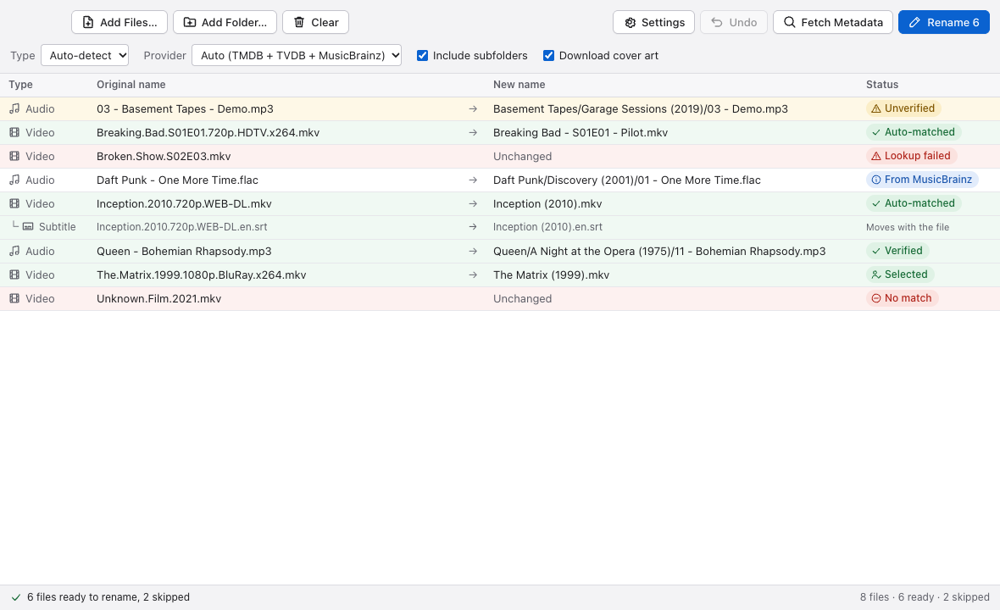
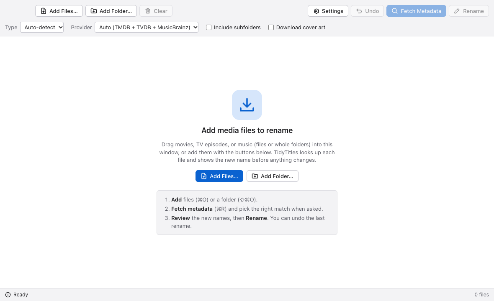
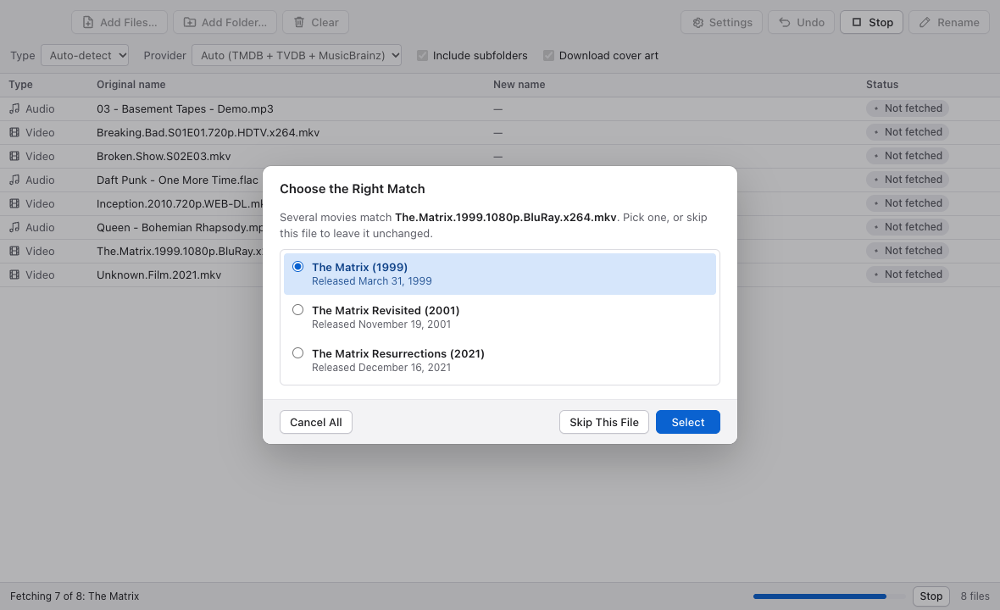
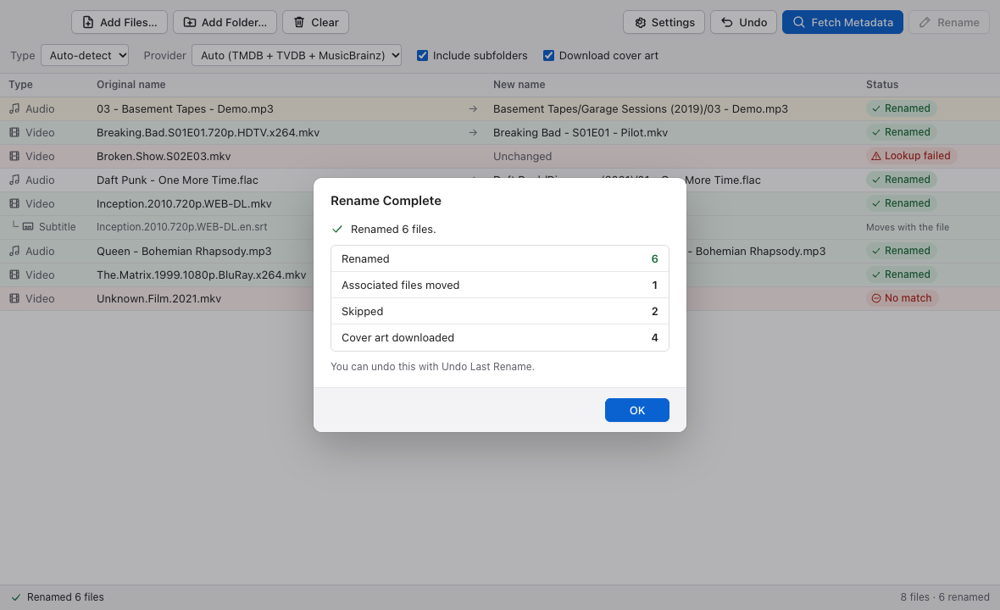
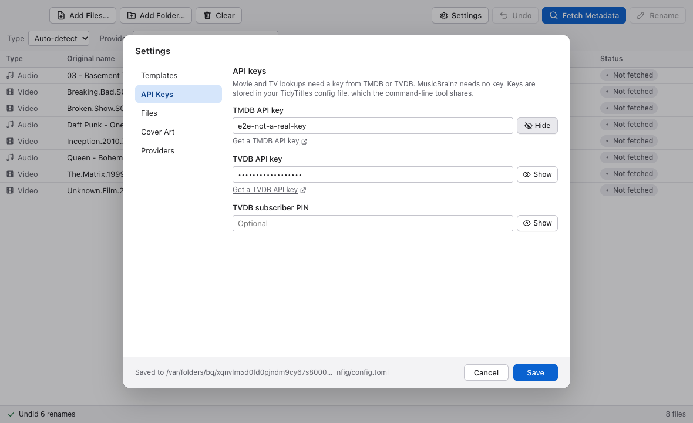
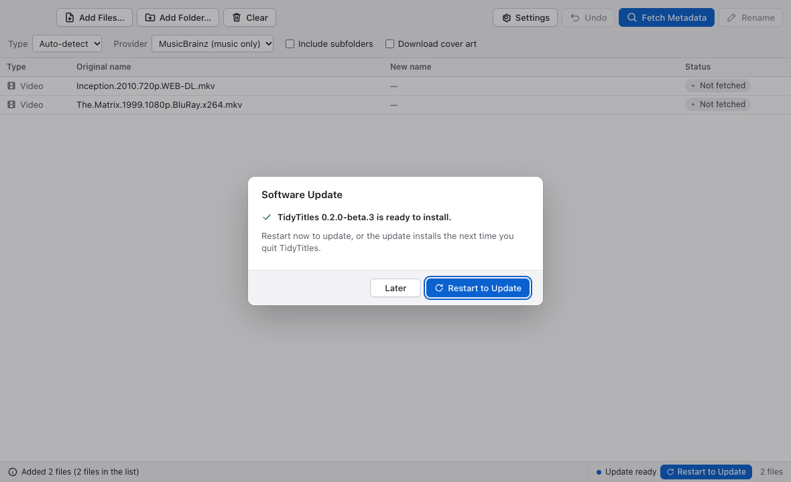

# GUI Guide

This page describes every part of the TidyTitles desktop app: adding files, fetching metadata, choosing matches, reading the status of each file, renaming, undoing, and the Settings window. To install the app, see [Installation](Installation.md).

## The window

From top to bottom:

- **Toolbar.** On the left: **Add Files…**, **Add Folder…**, **Clear**. On the right: **Settings**, **Undo**, **Fetch Metadata** (which turns into **Stop** while fetching), and **Rename** (which shows the number of files ready, for example **Rename 6**). On a narrow window the left-hand buttons show only their icons.
- **Options bar.** **Type**, **Provider**, **Include subfolders**, and **Download cover art**.
- **File list.** One row per file, with **Type** (Video or Audio), **Original name**, **New name**, and **Status**. Associated files (subtitles, `.nfo` files, images) appear in indented rows under their video, marked "Moves with the file".
- **Status bar.** A message about the last action on the left (or the progress of the current one, with a progress bar and a **Stop** button while fetching), and counts on the right, such as "8 files · 6 ready · 2 skipped". When there is news about an update, it appears just before the counts (see [Updates](#updates)).

The app keeps one window. Opening TidyTitles again brings the existing window to the front. The window size and position are remembered.

## 1. Add files

With an empty list, the window shows how to start:

There are several ways to add files. Each one adds to the list; nothing is removed.

- **Drag and drop** files or folders from Finder, File Explorer, or your file manager anywhere onto the window.
- **Open them with TidyTitles from outside the window**, even when it is not running yet:
  - macOS: drop files or folders on TidyTitles in the Dock (or on its icon in Applications). For a folder you can also Control-click it in Finder and choose **Open With** → **TidyTitles**. Video and audio files don't list TidyTitles under **Open With**, so drop them on the icon instead.
  - Windows: drop files or folders on the TidyTitles shortcut on the desktop (or on `TidyTitles.exe`).
  - Windows and Linux: name them on the command line, for example `TidyTitles "D:\Downloads\The.Matrix.1999.mkv"`.

  If TidyTitles is already running, they go to the open window. They are added the same way as a drop (below), and are refused, with a message, while a task is running or a dialog is open.
- **Add Files…** (Cmd+O on macOS, Ctrl+O on Windows and Linux) opens a file picker. You can select several files. The picker offers Media Files, Video Files, Audio Files, and All Files filters.
- **Add Folder…** (Shift+Cmd+O / Ctrl+Shift+O) opens a folder picker. You can select several folders.

What gets added:

- **Folders** are scanned for media files of the selected **Type**: video files for Movies and TV Shows, audio files for Music, and both for Auto-detect. Subfolders are scanned only when **Include subfolders** is checked *at the time you add the folder*.
- **Dropped files**, and files opened with TidyTitles from outside the window, are added only if their extension matches the selected Type.
- **Files chosen in Add Files…** are always added, whatever their extension.
- Hidden files and folders (names starting with `.`) are skipped when scanning. Extensions match regardless of case.
- A file that is already in the list is not added twice.

Recognized extensions:

- Video: `.mkv`, `.mp4`, `.avi`, `.mov`, `.wmv`, `.flv`, `.webm`, `.m4v`, `.mpg`, `.mpeg`, `.ts`, `.m2ts`
- Audio: `.mp3`, `.flac`, `.m4a`, `.ogg`, `.opus`, `.wav`, `.aiff`, `.wma`, `.aac`, `.ape`

To **remove** a file from the list, click its row and press Delete or Backspace. To empty the list, click **Clear** (Shift+Cmd+Backspace / Ctrl+Shift+Backspace). Removing files from the list never touches them on disk.

## 2. Choose the options

**Type** tells TidyTitles what kind of files these are:

| Choice | Effect |
|--------|--------|
| **Auto-detect** | Decides per file from its name (movie or TV episode); audio files are music. |
| **Movies** | Treats every video file as a movie. |
| **TV Shows** | Treats every video file as a TV episode. |
| **Music** | Adds only audio files. |

Audio files are always handled as music, whatever the Type.

**Provider** chooses which services are used. The menu lists only the choices your API keys allow:

| Choice | Movies | TV | Music |
|--------|--------|----|-------|
| **Auto (...)**, for example "Auto (TMDB + TVDB + MusicBrainz)" | TMDB | TVDB or TMDB (see [Providers](#providers)) | MusicBrainz |
| **TMDB (movies and TV)** | TMDB | TMDB | not looked up |
| **TVDB (TV shows)** | not looked up | TVDB | not looked up |
| **MusicBrainz (music)** | not looked up | not looked up | MusicBrainz |

With no TMDB or TVDB key, only **MusicBrainz (music only)** is offered, and the empty window shows "No TMDB or TVDB API key is set, so only music can be looked up" with a link to Settings. "Not looked up" means movie and TV files get **No match**; music files that are not looked up are still renamed from their own tags (status **Unverified**).

**Include subfolders** scans subfolders when you add a folder.

**Download cover art** downloads a poster or album cover after renaming (see [Cover art](#cover-art)). It starts checked or unchecked according to **Download cover art by default** in Settings.

**Transfer** chooses how files get their new names: **Move** (rename them, the default), **Copy** (make renamed copies and leave the originals), or **Hard link** (add the new name as a second name for the same data: no extra space, originals stay, only within one drive). It starts at the default chosen in **Settings** → **Output**. Changing it after fetching keeps the new names; you don't need to fetch again. The Rename button then says **Copy *N*** or **Link *N***.

**Output** shows where renamed files go: **Same folders** when files are renamed where they are, or the output folders, for example "Movies → Movies, TV → Shows" (hover to see the full paths). Click it to change them in Settings. See [Output folders](#output).

Changing Type or Provider after fetching clears the new names; fetch again to see the result.

## 3. Fetch metadata

Click **Fetch Metadata** (Cmd+R / Ctrl+R). For each file, TidyTitles reads the name (and the tags, for music), searches the right service, and works out the new name. The status bar shows progress, for example "Fetching 7 of 8: The Matrix".

To stop, click **Stop** in the toolbar or the status bar, choose **Rename** → **Stop Fetching** (Cmd+. / Ctrl+.), or press Esc. Nothing is renamed by fetching, so stopping is always safe; the list goes back to "Not fetched".

### Choosing the right match

When a search finds more than one result, TidyTitles asks:

Each match shows its title and year, and details such as the release date, network, or album. Then:

- **Select** (or Enter, or double-click a match) uses the selected match.
- **Skip This File** (or Esc) leaves the file unchanged; it is marked **No match**.
- **Cancel All** stops the whole fetch.

You are asked each question once per fetch. When later files produce the same list of matches (every episode of one show, or two copies of a movie), your answer, or your skip, is applied to them too. For music, once you pick a track, other files in the same folder take the match on the same album without asking. Click **Fetch Metadata** again to be asked afresh.

If none of the matches is right, skip the file and fix it afterward with **Change Match…** (see [Fix a match or a name](#fix-a-match-or-a-name)).

## 4. Review the new names

After fetching, the **New name** column shows each file's new name, relative to its current folder. A name that includes folders (from a template with `/`, such as the music default) shows those folders, for example `Queen/A Night at the Opera (1975)/11 - Bohemian Rhapsody.mp3`. **Unchanged** means the file will keep its name. Hover over a name to see the full path.

Rows are tinted: green for a confident match, amber for music whose tags could not be confirmed, red for files that will not be renamed. The **Status** badge says why; hover over it for a longer explanation.

**Ready to rename:**

| Status | Meaning |
|--------|---------|
| **Auto-matched** | Movie or TV: the search found exactly one result. |
| **Selected** | You picked this match: from several in the match dialog, or with **Change Match…**. |
| **Verified** | Music: the file's tags were confirmed on MusicBrainz. |
| **Unverified** | Music: the name comes from the file's own tags (or its filename), which MusicBrainz could not confirm or was not asked about. Check these. |
| **From MusicBrainz** | Music: the file's tags were incomplete, so the details come from a MusicBrainz search. |

**Will not be renamed:**

| Status | Meaning |
|--------|---------|
| **No match** | Nothing was found, the file was skipped in the match dialog, or the selected provider does not cover this kind of file. |
| **Lookup failed** | The service could not be reached or returned an error. Other files are not affected. |
| **API key rejected** | The service refused the API key. Check it in Settings. |
| **Rate limited** | The service is limiting requests. Try again in a minute. |
| **Template error** | The naming template could not be applied (for example `{episode\|pad:x}`). |
| **Duplicate name** | Another file in the list would get the same name (and the conflict setting is not **Add a number**). |
| **Left alone** | You cleared the file's match with **Clear Match**. |
| **Not fetched** | Fetch Metadata has not run since the file was added or the options changed. |

A name marked **Edited** next to it is one you typed (see below).

### Fix a match or a name

After a fetch, every row has a **…** button at its right end (the actions menu). It also opens with a right-click, the context menu key, or Shift+F10 on the selected row. These work for any file: matched, **No match**, skipped in the match dialog, or **Lookup failed**.

- **Change Match…** (Enter on the selected row) opens a search that starts with what TidyTitles searched for: the title and year it read from the name, and for TV the season and episode numbers. Change the words and press Enter or **Search**. For a video file, **Search as** switches between **Movie** and **TV episode**; for TV, correct the **Season** and **Episode** if the name had them wrong (you can change them after searching, too). Music is searched by **Title**, **Artist**, and **Album**. Pick a result and click **Use This Match** (or press Enter, or double-click it). The new name is worked out again, and so are conflicts with the rest of the list.
- **Also use this show for the other files named "…"**: when you pick a TV show and other files in the list have the same show title in their names, this box (checked by default) gives the show to all of them at once, each with its own season and episode. A season of 24 episodes matched to the wrong show needs one fix. Files whose episode the show does not have keep their match; the status bar says how many.
- **Edit New Name…** (F2) lets you type the new name. The extension stays, and so do any folders the template creates (music); subtitles and other files that go with it get the same name. Names with `/ \ : * ? " < > |`, names made only of dots, and names Windows reserves (such as `CON`) are refused, and so is a name another file in the folder already has. **Use Template Name** goes back to the name from the template.
- **Clear Match** leaves the file alone: it is marked **Left alone** and not renamed.

A file you changed is planned after the files you did not touch: if both would get the same name, the file you changed is the one marked **Duplicate name** (or numbered, with **Add a number**), and the other keeps its name. Changes last until the next **Fetch Metadata**, which starts over from the file names.

## 5. Rename

Click **Rename** (Cmd+Enter / Ctrl+Enter). A confirmation lists how many files will be renamed (or copied, or linked), how many associated files go with them, how many are skipped, which output folders they go to, and whether cover art will be downloaded. Click **Rename *N* Files** (or **Copy *N* Files**, **Link *N* Files**) to go ahead.

A new name in another folder (an output folder) is marked with a folder icon in the **New name** column and shown as the output folder's name followed by the path inside it, for example "Movies/Inception (2010).mkv". Hover to see the full path.

If an output folder is missing (for example, its drive isn't connected), Fetch Metadata stops with "The movie output folder doesn't exist (is the drive connected?)" and nothing can be renamed until it is back or the setting is changed. The folders are checked again when you click Rename, so a drive unplugged in between stops the whole rename before any file is touched.

In **Hard link** mode, a file whose new name would be on another drive shows **Can't link across drives** and is skipped (it is never copied instead).

Renaming cannot be interrupted, and the window will not close while it runs. While it runs, and while metadata is fetched, the TidyTitles icon in the Dock or taskbar shows a progress bar, so you can follow it from another app. If you switched to another app, TidyTitles also bounces its Dock icon once (macOS) or flashes its taskbar button (Windows) when it needs you to choose a match, and posts a notification when the rename (or an undo) finishes, for example "Renamed 6 files; 2 skipped". Click the notification to bring the window back. When it finishes, a summary appears:

The list now shows the new names, with the status **Renamed**, **Failed** (with the reason), or one of these, decided at the moment of renaming:

| Status | Meaning |
|--------|---------|
| **Already named** | The file already had its new name. |
| **Name taken** | A file with the new name already exists, and the conflict setting is **Skip the file** (or the existing file is part of the same rename). |

Folders that a template creates are made as needed. If an associated file cannot be moved, the main file still counts as renamed and the error is reported.

### Cover art

With **Download cover art** checked, TidyTitles saves, next to each renamed file:

- a poster for movies and TV episodes (from TMDB), named `poster.jpg` by default,
- an album cover for music (from the album's cover URL or the Cover Art Archive), named `cover.jpg` by default.

An existing poster or cover is kept unless **Replace cover art that is already there** is checked in Settings. Files in the same folder share one poster or cover. The file extension follows the image type (`.jpg`, `.png`, or `.webp`). A download that fails is skipped silently.

### Tags and NFO files

With **Write tags into music files** or **Write NFO files for media servers** turned on (**Settings** → **Files** → **Write metadata**), the confirmation says what will also be written, for example "Tags from MusicBrainz matches will be written into the 3 music files where they differ" and "NFO files will be written for 2 videos". In **Hard link** mode it says that tags won't be written, because the originals would change too.

After the rename, **Rename Complete** adds **Tags written**, **Tags already right**, **Tags not written**, **NFO files written**, and **NFO files not written**, and lists each file: the fields that changed (for example *title "Wrong Title" → "One More Time"*), and why anything was left alone (*tags of this format can't be written*, *a file of that name is already there*, *the episode isn't in a folder of its show*, and so on). See [Configuration](Configuration.md#writing-tags-into-music-files) for exactly what is written.

## 6. Undo

**Undo** (toolbar), or **Rename** → **Undo Last Rename…** (Cmd+Option+Z on macOS, Ctrl+Alt+Z on Windows and Linux), moves the files of the most recent rename back to their original names, associated files included. The confirmation shows how many files and when they were renamed, for example "Renamed Saturday, November 14 at 9:24 AM". Hover over the Undo button to see the same date.

Undo reads the rename history saved on disk, so it works after restarting the app, and it can undo a rename made with the command-line tool (or the Python version). The history keeps the last 200 renames (change it in **Settings** → **Output**); each Undo reverts the newest one that is left.

Undoing a copy or hard link deletes the copy or link, only if it is unchanged since the rename, and never touches the original.

Undo also puts back the tags a rename wrote into music files, and removes the NFO files it created if they are unchanged (a `tvshow.nfo` only when no episode is left in its folder). **Undo Complete** then shows **Tags put back** and **NFO files removed**, and lists files left as they were: tags of a file changed after the rename, an NFO file you edited, or a `tvshow.nfo` other episodes still use.

### Rename History

**History** (toolbar), or **Rename** → **Rename History…**, lists every rename in the history, newest first: when it happened (for example "Saturday, November 7 at 7:00 PM"), how many files, whether they were renamed, copied, or linked, and the first new name. **Undo…** next to an entry asks for confirmation and then undoes that entry, even if it isn't the newest. Later renames stay as they are. A file that a later rename moved away shows as not found. A file that is no longer the one this rename produced (replaced by another file, or a copy that was changed since) is left in place and listed under **Left in place** with the reason.

The **Undo Complete** summary shows:

- **Restored**: files moved back.
- **Not found (moved or deleted since)**: nothing was at the renamed path any more, so nothing was moved.
- **Left in place**: a file undo deliberately did not touch: it was replaced or changed after the rename, or it is a copy whose original is gone (so it may be the only copy). Copies whose originals are missing stay in the history, so undo works once the original's drive is back.
- **Failed**: the file could not be moved back, for example because its original name is now taken by another file. Undo never overwrites. Files that failed stay in the history, so you can fix the problem and click Undo again.

Folders created by the rename are not removed by Undo.

## Settings

Click **Settings** (Cmd+, / Ctrl+,). The footer shows where the settings are saved ("Saved to …/config.toml"). The command-line tool uses the same file. Changes take effect when you click **Save**; if names were already fetched, fetch again to apply them.

### Templates

**Naming preset** fills in all three templates at once with the naming a media server expects: **TidyTitles** (the defaults), **Plex**, **Jellyfin**, or **Kodi** (see [Naming presets](Templates.md#naming-presets)). The templates stay editable; once you change one, the picker shows **Custom**. Choosing a preset only fills the fields: nothing is saved until you click **Save**, and **Cancel** leaves your templates as they were.

One field each for **Movies**, **TV shows**, and **Music**. Below each field is a live **Preview** using sample metadata (The Matrix, Breaking Bad "Pilot", Pink Floyd "Comfortably Numb"). A template with an unknown placeholder or formatter, unbalanced braces or `<` `>`, or nothing in it shows the error in red and cannot be saved. **Placeholders and formatters** expands a reference table listing every placeholder, grouped (any type, movies and TV, from the original file name, music), with an example value for each. See [Templates](Templates.md).

### API Keys

**TMDB API key**, **TVDB API key**, and **TVDB subscriber PIN** (optional). Use **Show** / **Hide** to see what you typed. The **Get a TMDB API key** and **Get a TVDB API key** links open the sign-up pages. See [API Keys](API-Keys.md).

### Files

- **Rename associated files with the media file**, with separate checkboxes for **Subtitles** (`.srt`, `.sub`, `.ass`, `.ssa`, `.vtt`, `.idx`), **NFO files** (`.nfo`), and **Images** (`.jpg`, `.jpeg`, `.png`, `.tbn` with the video's name).
- **When the new name is taken**:
  - **Skip the file**: leave it with its old name (the default).
  - **Replace the existing file**: overwrite the file that already has the new name. Another file in the same batch is never overwritten.
  - **Add a number**: use the next free name, such as `The Matrix (1999) (1).mkv`.

- **Write metadata** (both off by default):
  - **Write tags into music files**: after renaming, write a MusicBrainz match's title, artist, album, album artist, track and disc numbers, year, and genre into MP3, FLAC, M4A, Ogg Vorbis, and Opus files, only where they differ. Other formats are renamed without tags; hard-linked files are never written to.
  - **Write NFO files for media servers**: an `.nfo` file next to each renamed movie and episode, and `tvshow.nfo` in a show's folder, for Kodi, Jellyfin, and Emby (Plex doesn't read them).

See [Configuration](Configuration.md#associated-files) for how associated files are matched, and [Writing tags into music files](Configuration.md#writing-tags-into-music-files) and [NFO files](Configuration.md#nfo-files) for what is written.

### Output

- **Output folders**: one each for **Movies**, **TV**, and **Music**. Type a path or click **Choose…**; **Clear** (or an empty field) renames those files where they are. Folders the template adds are created inside the output folder.
- **How files get their new names**: the default for the **Transfer** menu in the main window (**Move**, **Copy**, or **Hard link**).
- **Renames to keep**: how many renames the history keeps for undo (1 to 10,000; default 200).

See [Configuration](Configuration.md#output-folders-and-transfer-modes) for the details and safety rules.

### Watch

- **Watch these folders while TidyTitles is open**, the list of folders (**Add Folder…**, **Remove**), and **Include subfolders**.
- **When a new file has arrived**: **Review before renaming** (the default) or **Rename automatically when the match is certain**.
- **Wait until unchanged for**: the settle period in seconds (default 10).

See [Watch folders](#watch-folders) below.

### Cover Art

- **Download cover art by default**: the starting value of the **Download cover art** checkbox in the main window.
- **Poster file name** (default `poster.jpg`) and **Album cover file name** (default `cover.jpg`).
- **Poster size**: from Tiny (92 px wide) to Original size; the default is Large (500 px wide).
- **Replace cover art that is already there**.

### Providers

**TV shows**: whether TVDB or TMDB is preferred when the main window's Provider is **Auto** and both keys are set. If the preferred service has no key, the other one is used. Movies always use TMDB and music always uses MusicBrainz.

**Episodes and language**:

- **Episode order**: **Aired** (the broadcast order, right for most shows), **DVD**, or **Absolute** (one running number, as anime is often numbered). An order that the TV service in use has only for some shows is marked in the list, for example "DVD (only some shows on TMDB)", and the note below says what happens to the others. See [Configuration](Configuration.md#tv-and-metadata).
- **Metadata language**: the language for movie, show, and episode titles, listed by name. A title with no translation comes in English, then in the original language.

Files that hold several episodes (`Show.S01E01E02.mkv`) get one name for all of them, such as `Show - S01E01-E02 - First & Second.mkv`. Files named by date (`Show.2024.03.15.mkv`) and anime numbered without a season (`[Group] Show - 123.mkv`) are matched too.

### Updates

- **Check for updates automatically** (on by default): look for a new version shortly after starting and every few hours, and download it in the background. This setting is saved on this computer only, with the window position, not in `config.toml`; the command-line tool does not use it.
- The installed **Version** and the current update **Status**.

## Watch folders

TidyTitles can notice new media files arriving in folders you choose, such as your downloads folder, and look them up without your adding them. Turn it on in **Settings** → **Watch**: tick **Watch these folders while TidyTitles is open**, add one or more folders, and choose what happens to a new file.

Watching runs **only while TidyTitles is open**. There is no background service and no login item; quitting the app stops watching. (For watching around the clock, see `tidytitles watch` in the [CLI Reference](CLI-Reference.md#watch).)

- **A file is touched only once it has finished arriving**: its size and modification time have not changed for the settle period, and it does not have a temporary download name such as `.part`, `.crdownload`, or `.download`. See [Configuration → Watch folders](Configuration.md#watch-folders) for the full rules.
- **Review before renaming**: new files are added to the file list and their metadata is fetched, just as if you had added them and clicked **Fetch Metadata**. If a search finds several matches you are asked which one. Nothing is renamed until you click **Rename**.
- **Rename automatically when the match is certain**: a file is renamed without asking only when the lookup finds exactly one match and nothing already has its new name. Files with several matches, no match, a failed lookup, or a name that is taken are added to the file list for review instead. Automatic renames are in **History** and can be undone there.
- **While TidyTitles is busy** (fetching, renaming, or with a dialog open), new files wait and are taken as soon as it is free. Adding them starts a new fetch of the whole list, as adding any files does, so matches you changed by hand in the current list are fetched again.
- **Files already in a folder** when watching starts are left alone. To process them, open the watch activity and click **Process Existing Files**.

**The status bar** shows whether watching is on: **Watching · Review** or **Watching · Automatic** with a green dot, **Watching paused**, or **Watch folder missing** (red) when a folder is not there (for example, a drive is not connected; it is watched again when it comes back). It also shows how many files are arriving, and a badge counts what happened since you last looked. **Pause** stops watching until you click **Resume** or restart the app; files that arrived while paused are picked up on resume.

**Watch Activity** (click the status-bar indicator) lists what the watcher did since the app started: files **Renamed** automatically, files added **For review** and why, files **Skipped** (gone before they finished arriving, unreadable), lookups **Retrying** after a service failure and when they are tried next, and **Folders** that went missing or came back. Buttons there process the files that were already in the folders, retry failed lookups now, and open the Watch settings. The log is kept until you quit; automatic renames stay in History.

When files are renamed automatically or wait for review while the TidyTitles window is in the background, a notification says so.

## Updates

TidyTitles checks for a new version about 15 seconds after it starts and then every 4 hours (unless you turned that off in Settings). Downloads happen in the background and never interrupt your work. The status bar shows what is going on, right before the file counts:

- **Downloading update** with a small progress bar and the percentage. Click it for details.
- **Update ready** with a **Restart to Update** button. TidyTitles quits, installs the new version, and opens again; your window size and position are kept. If files are in the list, it asks first, because the list is cleared. While files are being fetched, renamed, or restored, the button is grayed out until the task finishes. If you never click it, the update installs when you quit TidyTitles.
- **TidyTitles *version* is available** with a **Download** button, when this copy cannot install updates itself (for example an unsigned Mac build) or when installing failed. **Download** opens the release page in your browser.

**Check for Updates…** (in the **TidyTitles** menu on macOS, the **Help** menu on Windows and Linux) opens the **Software Update** dialog, which follows the check from start to end:

- **Checking for updates…**, with **Cancel** to close the dialog (the check finishes in the background).
- **TidyTitles is up to date**, with the version you have.
- **Downloading TidyTitles *version*…** with progress; **Hide** keeps it going in the background.
- **TidyTitles *version* is ready to install**, with **Later** and **Restart to Update**.
- **TidyTitles *version* is available**, with the reason this copy cannot install it and **Download**.
- **Couldn't check for updates**, with the reason in plain words (no internet connection, the server took too long, no update information), **Try Again**, and **Open Releases Page**.

If another dialog is open when you choose **Check for Updates…**, the result appears in the status bar instead (dismiss it with ×). Checks that run on their own never show an error; they try again later. What each system supports is described in [Installation](Installation.md#updates).

## Keyboard shortcuts

| Action | macOS | Windows and Linux |
|--------|-------|-------------------|
| Add Files… | Cmd+O | Ctrl+O |
| Add Folder… | Shift+Cmd+O | Ctrl+Shift+O |
| Clear List | Shift+Cmd+Backspace | Ctrl+Shift+Backspace |
| Settings… | Cmd+, | Ctrl+, |
| Fetch Metadata | Cmd+R | Ctrl+R |
| Stop Fetching | Cmd+. or Esc | Ctrl+. or Esc |
| Rename Files… | Cmd+Enter | Ctrl+Enter |
| Undo Last Rename… | Cmd+Option+Z | Ctrl+Alt+Z |
| Quit | Cmd+Q | Ctrl+Q |

In the file list: Up and Down arrows, Page Up, Page Down, Home, and End move the selection; Delete or Backspace removes the selected file from the list; Esc clears the selection. After a fetch, Enter opens **Change Match…** for the selected file, F2 opens **Edit New Name…**, and Shift+F10 or the context menu key opens its actions menu (Tab from the row also reaches its **…** button). In dialogs, Enter confirms and Esc cancels (in the match dialog, Esc skips the file; in **Change Match**, Enter in a search field searches).

View → Actual Size, Zoom In, and Zoom Out change the text size.

## Menus

- **TidyTitles** (macOS only): About, **Check for Updates…**, **Settings…**, **Install Command Line Tool…**, Hide, Quit.
- **File**: **Add Files…**, **Add Folder…**, **Clear List**; on Windows and Linux also **Settings…**, **Install Command Line Tool…**, and **Quit**.
- **Edit**: the usual text editing commands, for the text fields in Settings. Edit → Undo undoes typing; it does not undo renames.
- **Rename**: **Fetch Metadata**, **Stop Fetching**, **Rename Files…**, **Undo Last Rename…**, **Rename History…**.
- **View**: zoom and full screen.
- **Window**: the standard window commands.
- **Help**: **TidyTitles on GitHub**, **Template Reference**, **Report an Issue** (each opens your browser); on Windows and Linux also **Check for Updates…** and About.

**Install Command Line Tool…** is described in [Installation](Installation.md#the-command-line-tool).

## Tips

- **A file matched the wrong title.** Use **Change Match…** on its row and search with better words (see [Fix a match or a name](#fix-a-match-or-a-name)). For a TV show, the fix can go to every episode at once. Setting **Type** to Movies or TV Shows also helps when Auto-detect guesses wrong.
- **Large collections.** API responses are cached for 24 hours, so fetching the same files again is fast. Movie and TV lookups run several at a time. MusicBrainz allows one request per second: tracks of one album with complete tags are checked together in about two requests, but music without complete tags needs a request per file, so large batches of it take a while.
- **Trying things out safely.** Fetching never changes anything on disk. Only **Rename** does, and **Undo** reverts it.
- **Using another settings folder** (for example to test): start the app with the `TIDYTITLES_CONFIG_DIR` environment variable set. See [Configuration](Configuration.md#using-a-different-settings-folder).

For problems, see [Troubleshooting](Troubleshooting.md#desktop-app).
