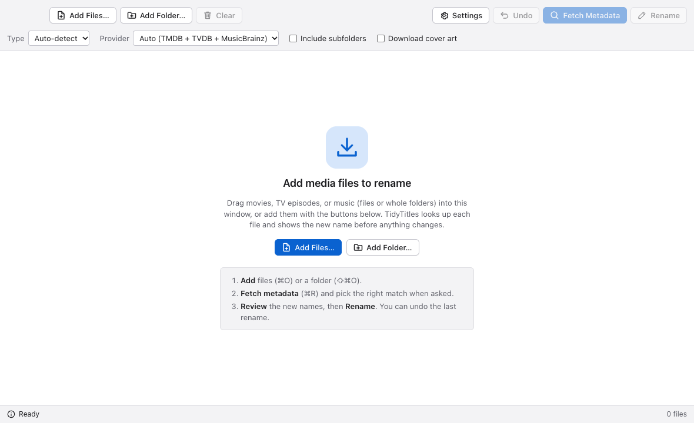

# Getting Started

This page walks you through your first rename, first in the desktop app and then on the command line. It ends with notes for people coming from the Python version of TidyTitles.

## Step 1: Install

Install the desktop app from a release, or build from source. See [Installation](Installation.md). If you want the `tidytitles` command too, follow [The command-line tool](Installation.md#the-command-line-tool).

## Step 2: Get an API key (movies and TV only)

| You rename... | You need |
|---------------|----------|
| Music only | Nothing. MusicBrainz needs no key. |
| Movies | A TMDB key |
| TV episodes | A TMDB key or a TVDB key (either one works) |

One TMDB key covers both movies and TV. [API Keys](API-Keys.md) explains how to get one; it is free and takes a few minutes.

## Step 3: Rename in the desktop app

1. **Open TidyTitles** and click **Settings** (or press Cmd+, on macOS, Ctrl+, on Windows and Linux). On the **API Keys** tab, paste your key into **TMDB API key** and click **Save**.
2. **Add files.** Drag files or whole folders into the window (or onto TidyTitles in the Dock or on the Windows shortcut), or click **Add Files…** or **Add Folder…**. Check **Include subfolders** first if your folder has subfolders.

   

3. **Click Fetch Metadata.** TidyTitles reads each name and looks it up. If a search finds several possible matches, it asks you to choose. Pick the right one and click **Select**, or click **Skip This File**.
4. **Review the list.** The **New name** column shows what each file will be called, and the **Status** column says how sure the match is. Files marked **No match** or **Lookup failed** are left alone.
5. **Click Rename** and confirm. A summary shows how many files were renamed.
6. **Undo if needed.** Click **Undo** to put the last batch back.

The [GUI Guide](GUI-Guide.md) explains each control and status in detail.

## Step 3 (alternative): Rename on the command line

Save your key once:

```bash
tidytitles config set-key tmdb YOUR_TMDB_API_KEY
```

Check what TidyTitles sees in your filenames. `preview` only parses names; it does not look anything up:

```bash
tidytitles preview ~/Downloads
```

```
Parsed File Information
┌──────────────────────────────────────────┬────────────┬──────────────┬──────┬────────┬─────────┐
│ Filename                                 │ Type       │ Title        │ Year │ Season │ Episode │
├──────────────────────────────────────────┼────────────┼──────────────┼──────┼────────┼─────────┤
│ Breaking.Bad.S01E01.720p.BluRay.x264.mkv │ tv_episode │ Breaking Bad │ -    │ 1      │ 1       │
│ The.Matrix.1999.1080p.BluRay.x264.mkv    │ movie      │ The Matrix   │ 1999 │ -      │ -       │
└──────────────────────────────────────────┴────────────┴──────────────┴──────┴────────┴─────────┘
```

See the new names without renaming anything:

```bash
tidytitles rename ~/Downloads --dry-run
```

When you are happy, rename. You are shown the same preview and asked `Proceed with rename? [y/N]`:

```bash
tidytitles rename ~/Downloads
```

If a search finds several matches, you choose from a list (or skip the file). Add `--auto-select` to always take the first result, and `--yes` to skip the confirmation, for example in a script:

```bash
tidytitles rename /media/inbox --recursive --yes --auto-select
```

Undo the last rename:

```bash
tidytitles undo
```

The [CLI Reference](CLI-Reference.md) lists every option.

## Step 4: Adjust the naming (optional)

The default names are:

| Type | Template | Example |
|------|----------|---------|
| Movies | `{title} ({year})` | `The Matrix (1999).mkv` |
| TV | `{title} - S{season2}E{episode2} - {episode_title}` | `Breaking Bad - S01E01 - Pilot.mkv` |
| Music | `{artist}/{album} ({year})/{track2} - {title}` | `Pink Floyd/The Wall (1979)/06 - Comfortably Numb.flac` |

Change them in the app (**Settings** → **Templates**, with a live preview) or on the command line:

```bash
tidytitles config set-template movie "{title} ({year}) [{quality}]"
tidytitles config set-template tv "{title}/Season {season2}/{title} - S{season2}E{episode2}"
```

[Templates](Templates.md) lists every placeholder and formatter.

## Coming from the Python version

If you used the Python app (`file-renamer` and `file-renamer-gui`):

**What stays the same**

- **Your settings and history.** TidyTitles uses the same `config.toml` and `history.json`, in the same folder, in the same format. Your API keys and templates are picked up automatically, and `tidytitles undo` can undo the last rename the Python app made. The files stay readable by the Python app, so you can switch back. See [Configuration](Configuration.md).
- **The cache.** API responses cached by one are used by the other.
- **The command name.** `file-renamer` is installed as a second name for the CLI when you run it from a source checkout (`npx file-renamer ...`). Commands, options, and short flags are the same as before (`rename`, `preview`, `undo`, `config show`, `config init`, `config set-key`, `config set-template`). The **Install Command Line Tool…** menu item installs only the `tidytitles` name. If the Python package is still installed, its `file-renamer` command may be the one your shell finds first.

**What changed**

| Before (Python) | Now |
|-----------------|-----|
| A rename that only changed letter case failed with "Destination already exists" on case-insensitive disks (most Mac and Windows disks). | Case-only renames work. |
| One failed lookup (network error, rejected API key, rate limit) stopped the whole batch. | That file is skipped with **Lookup failed** and the rest continue. |
| The CLI exited 0 even when some files failed. | The CLI exits 1 when any rename or lookup failed. See [Exit codes](CLI-Reference.md#exit-codes). |
| `conflict_resolution = "overwrite"` quietly skipped files whose new name was taken. | It replaces the existing file, except another file that is part of the same batch. See [Conflict resolution](Configuration.md#conflict-resolution). |
| The GUI could undo only within the same session. | Undo uses the saved history in both the app and the CLI, also after a restart. |
| Hidden files could be picked up, and extensions were case-sensitive. | Hidden files and folders (names starting with `.`, including macOS `._` files) are skipped; `.MKV` and `.mkv` both count. |
| Choosing Movies or TV Shows could send music files to the movie or TV lookup. | Music files are always looked up as music. |
| API keys had to be set with the CLI before using the GUI. | The desktop app has its own **Settings** window. |

Settings that the new app stores but does not use are listed in [Configuration](Configuration.md#settings-reference).

## Next steps

- [GUI Guide](GUI-Guide.md): every control in the desktop app
- [CLI Reference](CLI-Reference.md): every command and option
- [Templates](Templates.md): customize names and folders
- [Configuration](Configuration.md): conflict handling, associated files, cover art
- [Troubleshooting](Troubleshooting.md): when something does not work
